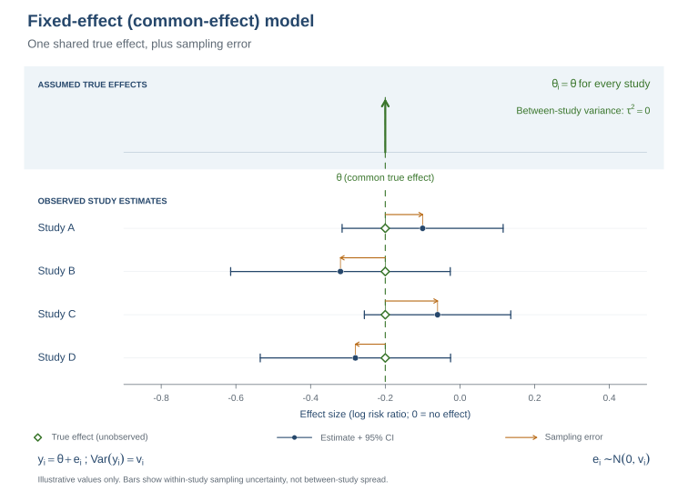
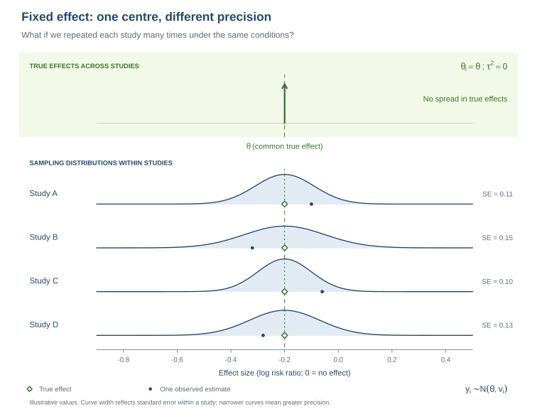

::: {.callout-note title="How to use this solution"}
This page follows the companion [task page](part2_fixed_effects_task.html). It includes the same explanations, figures, tasks, and discussion prompts, followed by worked output comments and answers.
:::

# 1. Summary

In Part 1, you calculated a risk ratio (RR) for ongoing pregnancy in each study. Here, you will compare the arithmetic mean of those study RRs with an inverse-variance estimate under a common-effect model. You will then examine how much the study estimates vary, calculate an approximate interval for the result of a future study, and explore funnel plots and small-study diagnostics. The analyses use seven studies, so interpret measures of heterogeneity and funnel-plot diagnostics cautiously.

# 2. Learning objectives

- Explain how an unweighted mean differs from inverse-variance pooling.
- Calculate and interpret a common-effect pooled RR and confidence interval.
- Read a forest plot and interpret Cochran’s Q and I² with appropriate caution.
- Distinguish uncertainty about a pooled effect from an interval for a future study’s observed estimate.
- Describe what a funnel plot, Egger’s regression test, and trim-and-fill can and cannot show.

## Prepare the data

Run this setup once before starting the analyses. Calculate each arm's observed risk, then use `metafor::escalc()` to calculate the study log RR and its sampling variance for the meta-analysis.

```{r}
#| warning: false
library(metafor)
library(knitr)
dat <- readRDS("ongoing_pregnancy_deae274.rds")
dat$risk_b <- dat$biosimilar_events / dat$biosimilar_total
dat$risk_o <- dat$originator_events / dat$originator_total
es <- metafor::escalc(measure = "RR", ai = biosimilar_events,
  bi = biosimilar_total - biosimilar_events, ci = originator_events,
  di = originator_total - originator_events, data = dat)
dat$rr <- dat$risk_b / dat$risk_o
dat$yi <- es$yi
dat$vi <- es$vi
dat$sei <- sqrt(dat$vi)
```

# 3. Unweighted average of study risk ratios

The arithmetic mean assigns equal weight to every study, regardless of how precisely its RR was estimated. For an approximate standard error, we first use the delta method to translate each log-RR variance, $v_i$, to the RR scale: $\mathrm{Var}(RR_i)\approx RR_i^2v_i$. Assuming the study estimates are independent, the variance of their mean is then:

$$\bar{RR}=\frac{1}{k}\sum_{i=1}^k RR_i,\qquad \mathrm{Var}(\bar{RR})\approx\frac{1}{k^2}\sum_{i=1}^k RR_i^2v_i.$$

{#fig-unweighted-average-rr width="100%" fig-alt="Seven observed study risk ratios shown as equal-sized dots on a linear RR scale. Each receives weight one seventh. The arithmetic mean is 0.876 and the no-difference reference is RR 1."}

**Read the diagram:** The seven observed study RRs and their equal-weight arithmetic mean. The orange line marks the mean; the grey line marks RR = 1.

Each dot represents one study’s observed RR, and each contributes $1/7$ to the mean. The figure omits confidence intervals to focus on equal weighting; the approximate uncertainty calculation below does use the study variances. RR = 1 indicates equal observed risks in the two treatment arms.

**Tasks:**

1.  Calculate the arithmetic mean of the study RRs.

2.  Estimate its standard error and approximate 95% CI using the variance formula above.

3.  Report the mean and interval, then describe what quantity this mean summarizes.

```{r}
k <- nrow(dat)
theta_unweighted <- mean(dat$rr)
var_theta_unweighted <- sum(dat$rr^2 * dat$vi) / k^2
se_theta_unweighted <- sqrt(var_theta_unweighted)
ci_unweighted <- theta_unweighted + c(-1, 1) * qnorm(0.975) * se_theta_unweighted
kable(data.frame(
  mean_RR = theta_unweighted,
  variance = var_theta_unweighted,
  SE = se_theta_unweighted,
  CI_lower = ci_unweighted[1],
  CI_upper = ci_unweighted[2]
), digits = 3, caption = "Unweighted mean of study RRs (descriptive benchmark)")
```

**Comments on the output:** The arithmetic mean is RR 0.876 (approximate 95% CI 0.678 to 1.074). It gives each of the seven observed study RRs equal influence. Because the studies differ in precision, treat this as a descriptive benchmark rather than a precision-weighted meta-analysis. Its interval is approximate: it uses the delta-method variances and a normal approximation.

**Questions to discuss:**

1.  How does this arithmetic mean differ from an estimate of one shared true effect?
2.  Which assumptions and approximations support the standard error and CI?
3.  Why can giving a small, imprecise study the same influence as a large, precise study be problematic? What is the value of this average as a benchmark?


::: {.callout-tip title="Answers"}

1. **What does the average describe?** It is the arithmetic mean of the seven observed study RRs, with each study weighted equally. It is not an estimate of one shared true effect.
2. **What assumptions support its standard error and CI?** The study estimates are treated as independent. The RR-scale variances are approximated from the log-RR variances using the delta method, and the CI uses a normal approximation.
3. **Why can the unweighted mean be a poor summary, and when is it useful?** A small, imprecise study has as much influence as a large, precise study, which can make the summary inefficient. Here, the mean is useful as a simple descriptive benchmark for comparison with inverse-variance pooling.

:::

# 4. Fixed-effect inverse-variance model

The common-effect model assumes that every study has the same underlying true log RR, $\theta$. The observed study estimates can differ because of sampling error, and studies with smaller sampling variances receive more weight. In `metafor`, this model is selected with `method = "FE"`:

$$y_i\sim N(\theta,v_i),\qquad w_i=1/v_i,\qquad \hat\theta=\frac{\sum_iw_iy_i}{\sum_iw_i},\qquad \mathrm{Var}(\hat\theta)=\frac{1}{\sum_iw_i}.$$

{#fig-fixed-effect-model width="100%" fig-alt="One shared true effect for four studies, with observed estimates differing because of sampling error and confidence intervals of different widths."}

**Read the diagram:** Fixed-effect model: all four unobserved true study effects (open green diamonds) lie on the same dashed line. Observed estimates (blue dots) differ because of sampling error (orange arrows). Horizontal bars are within-study 95% confidence intervals. Here the true effects are the same, while the observed estimates differ because of sampling error. The study CIs can have different widths because studies have different precision.

Now, imagine repeating each study many times under the same conditions. The estimates would form sampling distributions centred on the common true effect. Their widths reflect within-study standard errors. The sampling distributions have the same centre, but their widths differ with study precision:

{#fig-fixed-effect-sampling width="100%" fig-alt="Four normal sampling distributions share one true log risk ratio, with different standard errors. Their centres align and their widths differ. A single observed estimate is marked for each study."}

**Read the diagram:** Fixed-effect sampling distributions: the four blue bell curves have the same centre but different widths. Green diamonds identify the common true effect; blue dots show one illustrative observed estimate per study.

The pooled estimate and its confidence limits are calculated on the log scale. Exponentiating them gives the pooled RR and its 95% CI on the RR scale.

**Main task:** Fit the fixed-effect model with `metafor` and report the pooled RR and 95% CI. Compare the estimate and standard error with the Part 2 result.

```{r}
fe <- metafor::rma(yi, vi, data = dat, method = "FE", test = "z",
                   slab = study_label)
kable(data.frame(
  Log_RR = as.numeric(coef(fe)), SE = fe$se,
  RR = exp(as.numeric(coef(fe))),
  CI_lower_RR = exp(fe$ci.lb), CI_upper_RR = exp(fe$ci.ub)
), digits = 3, caption = "metafor fixed-effect pooled estimate")
```

::: {.callout-note title="Optional: reproduce the pooled estimate manually"}
Calculate the inverse-variance weights, pooled log RR, its variance and standard error, and the 95% confidence interval. Exponentiating the pooled estimate and confidence limits converts them to the RR scale. Use the `metafor` model above as the primary analysis.
:::

```{r}
w_fe <- 1 / dat$vi
theta_fe <- sum(w_fe * dat$yi) / sum(w_fe)
var_theta_fe <- 1 / sum(w_fe)
se_theta_fe <- sqrt(var_theta_fe)
ci_fe_log <- theta_fe + c(-1, 1) * qnorm(0.975) * se_theta_fe
kable(data.frame(
  Log_RR = theta_fe, Variance = var_theta_fe, SE = se_theta_fe,
  RR = exp(theta_fe), CI_lower_RR = exp(ci_fe_log[1]),
  CI_upper_RR = exp(ci_fe_log[2])
), digits = 3, caption = "Optional manual fixed-effect check")
```

**Comments on the output:** The `metafor` fit gives a pooled RR of 0.810 (95% CI 0.701 to 0.935). The optional manual calculation gives the same result. Under the common-effect assumption, this estimates one shared true relative risk across the included studies. The interval excludes RR = 1, indicating a lower estimated ongoing-pregnancy risk in the biosimilar arms under this model. The CI describes uncertainty in the pooled estimate; it is not a range of individual outcomes or a test of equivalence. The model also assumes independent study estimates and adequate within-study variance estimates, and it does not include between-study variation in true effects.

## Forest plot

In the forest plot, the study estimates and their confidence intervals appear alongside the pooled estimate. The vertical reference line at RR = 1 represents equal ongoing-pregnancy risks in the two arms. Study weights reflect inverse sampling variance; they do not measure study quality.

```{r}
forest(fe, atransf = exp, refline = 0,
       xlab = "Risk ratio (biosimilar / GONAL-f)",
       main = "Fixed-effect inverse-variance model")
```

**Questions to discuss:**

1.  What does the common-effect assumption say about true effects across studies, and when might it be credible?
2.  Interpret the pooled RR and CI in the context of the outcome and treatment arms. What does the CI not tell you?
3.  In the forest plot, identify study estimates and CIs, relative weights, the pooled estimate and CI, and the RR = 1 reference line. What can overlap or non-overlap of study CIs tell you?
4.  Why do the unweighted mean and inverse-variance estimate differ here? Which target does each summarize?


::: {.callout-tip title="Answers"}

1. **What does the common-effect assumption mean?** Each study has the same underlying true log RR, and observed differences arise from sampling error. It is most credible when populations, treatment contrasts, outcome definitions, and follow-up are sufficiently comparable.
2. **How should the pooled RR and CI be interpreted?** RR 0.810 means the estimated ongoing-pregnancy risk in the biosimilar arms is 0.810 times that in the GONAL-f arms. The 95% CI (0.701 to 0.935) excludes 1, conditional on the model. This does not establish equivalence or guarantee the same effect for every biosimilar product.
3. **How do you read the forest plot?** Each square is a study RR, with its size reflecting inverse-variance weight; each horizontal line is its 95% CI. The diamond is the pooled estimate and CI, and the vertical line at RR = 1 marks equal risks. Overlapping study CIs do not prove the true effects are identical.
4. **Why do the unweighted and pooled estimates differ?** The unweighted mean gives all studies equal influence, while inverse-variance pooling gives more influence to more precise studies. They summarize different quantities: the average of observed study RRs versus a shared true effect under the common-effect assumption. Their numerical difference does not validate that assumption.

:::

# 5. Heterogeneity: Cochran’s Q and I²

The common-effect model treats all differences between observed study estimates as sampling error. **Cochran’s Q assesses** whether the observed spread is larger than expected from sampling error alone. Under the common-effect model, Q is compared with a chi-square distribution with $k-1$ degrees of freedom; here, $k=7$, so there are 6 degrees of freedom. A large Q relative to those degrees of freedom, together with a small p-value, is evidence that the observed estimates are more dispersed than the model predicts.

**I²** is an estimate of the proportion of the observed variation that is associated with between-study heterogeneity rather than sampling error. It is calculated from Q and is conventionally truncated at 0% when Q is less than its degrees of freedom. An estimate of 0% does not prove that all true study effects are identical, particularly when only a few studies are available.

The formulas are $Q=\sum w_i(y_i-\hat\theta)^2$ and $I^2=\max(0,(Q-(k-1))/Q)\times100\%$.

**Main task:** Read Q, its degrees of freedom and p-value, and I² from the `metafor` output. Summarize what they suggest about between-study spread and note the limits of that conclusion.

```{r}
kable(data.frame(
  Measure = c("Q", "Degrees of freedom", "Q p-value", "I-squared (%)"),
  Value = c(fe$QE, fe$k - 1, fe$QEp, fe$I2)
), digits = 3, caption = "metafor heterogeneity statistics")
```

::: {.callout-note title="Optional: check Q and I² manually"}
You can verify the model output using the common-effect weights and pooled estimate:

```{r}
w_fe <- 1 / dat$vi
theta_fe <- sum(w_fe * dat$yi) / sum(w_fe)
Q_manual <- sum(w_fe * (dat$yi - theta_fe)^2)
df_Q <- nrow(dat) - 1
Q_p_manual <- pchisq(Q_manual, df = df_Q, lower.tail = FALSE)
I2_manual <- max(0, (Q_manual - df_Q) / Q_manual) * 100
c(Q = Q_manual, df = df_Q, p_value = Q_p_manual, I2_percent = I2_manual)
```
:::

**Comments on the output:** The manual and `metafor` calculations agree: Q = 1.816 on 6 degrees of freedom (p = 0.936), and I² = 0%. Q is below its degrees of freedom, so this analysis does not find more spread among the study estimates than expected from sampling error. Since Q − df is negative, the I² estimate is truncated to 0%.

**Questions to discuss:**

1.  In plain language, what does Q compare, and what does this Q value suggest relative to its degrees of freedom?
2.  Why is I² truncated to 0% for these results?
3.  Does I² = 0% establish that the true effects are identical? How should the small number of studies affect your interpretation?


::: {.callout-tip title="Answers"}

1. **What does Q tell us?** It compares the observed spread among study estimates with the spread expected from sampling error under the common-effect model. Here, Q = 1.816 is below 6 degrees of freedom, and its p-value does not indicate extra dispersion.
2. **Why is I² = 0%?** Since Q is below its degrees of freedom, the untruncated formula is negative. I² is conventionally not reported below 0%, so it is set to zero.
3. **Does I² = 0% prove identical effects?** No. It means this calculation did not detect excess spread. With seven studies, small or moderate true differences could go undetected.

:::

# 6. Interval for a future observed study estimate

The pooled RR and its 95% CI from Section 4 summarize the seven studies in this analysis. Under the common-effect assumption, that CI describes uncertainty about their shared true effect. This section asks a different question: how much might the **observed RR estimate from one new study** vary? Even if the new study has the same true effect, its observed estimate will also have sampling error. The approximate interval below combines uncertainty in the pooled estimate with the expected sampling variance of the new estimate:

$$\hat\theta\pm1.96\sqrt{\mathrm{Var}(\hat\theta)+v_{new}}.$$

This interval is for a future study’s **observed estimate**, not its true effect or an individual participant’s outcome. The common-effect assumption says the future study shares the same true effect as the included studies; the interval is wider than the pooled confidence interval because it also includes the new study’s sampling error. Using the median of the observed study variances as $v_{new}$ makes this an approximation and assumes that the median is representative of a future study’s precision.

```{r}
v_new <- median(dat$vi)
pi_observed <- exp(theta_fe + c(-1, 1) * qnorm(0.975) *
                     sqrt(var_theta_fe + v_new))
kable(data.frame(
  representative_future_variance = v_new,
  observed_RR_lower = pi_observed[1],
  observed_RR_upper = pi_observed[2]
), digits = 3, caption = "Approximate interval for a future observed study estimate")
```

**Comments on the output:** The approximate interval for one future observed estimate is RR 0.557 to 1.176, wider than the pooled 95% CI (RR 0.701 to 0.935).

| Interval | Question answered | Result |
|---|---|---|
| Pooled 95% CI | How uncertain is the shared effect estimated from the included studies? | RR 0.701 to 0.935 |
| Future observed-estimate interval | Where might the observed RR from one new study fall, allowing for its sampling error? | RR 0.557 to 1.176 |

The future interval is for an observed study estimate, not a future true effect or an individual outcome. It is wider because it includes both uncertainty in the pooled estimate and sampling error in the new study. It relies on the common-effect model, a normal approximation, and the assumption that the median observed study variance is representative of a future study’s variance.

**Tasks:**

1.  Calculate the approximate interval for one future study’s observed RR estimate using the median study variance as a stand-in for the future study’s variance.

2.  Compare its limits with the pooled 95% CI from Section 4 and explain why the intervals differ.

3.  State what the future interval covers and the key assumptions used to construct it.


::: {.callout-tip title="Answers"}

1. **What interval was calculated?** An approximate interval for the observed RR estimate from one future study, using the median of the included studies’ variances as a stand-in for that study’s variance.
2. **Why is it wider than the pooled CI?** The pooled CI reflects uncertainty about the common effect estimated from the included studies. The future observed-estimate interval also includes the new study’s sampling error.
3. **What does it cover, and what assumptions does it use?** It covers a future observed study estimate, not its true effect or an individual participant’s outcome. It assumes a common true effect, a normal approximation, and that the median observed variance represents the future study’s precision.

:::

# 7. Funnel plot and small-study diagnostics

**Tasks:**

1.  Draw and inspect a funnel plot. Identify what each point, axis, reference line, and pseudo-confidence limit represents. Describe the pattern without treating it as proof of a cause.
2.  Run Egger’s regression test and trim-and-fill. Record the test result and the number of studies trim-and-fill adds, if any.
3.  Interpret both outputs cautiously in light of the seven-study sample. Distinguish evidence about asymmetry from evidence about its possible causes.

```{r}
funnel(fe, yaxis = "sei", refline = as.numeric(coef(fe)),
       xlab = "Log risk ratio", ylab = "Standard error")
```

The **funnel plot** shows each study’s log RR against its standard error. More precise estimates appear near the top and less precise estimates near the bottom. The vertical line marks the pooled log RR, and the diagonal pseudo-confidence limits show the expected spread around that estimate under the model. A roughly symmetric funnel can be consistent with an absence of small-study effects, but it cannot establish that they are absent. An asymmetric pattern can arise by chance, from differences between studies, or from selective availability of results. With only seven studies, the plot and formal asymmetry tests are especially uncertain; the often-cited threshold of ten studies is only a rough guide.

**Egger’s regression test** (`regtest`) assesses funnel-plot asymmetry by testing for a relationship between study estimates and their standard errors. Its result does not identify the cause of any asymmetry. **Trim-and-fill** is a separate adjustment: it estimates how many studies may be missing on one side of the funnel, adds hypothetical studies to make the plot more symmetric, and recalculates the pooled estimate. It is not an asymmetry test, and its estimate depends on strong assumptions.

```{r}
egger_demo <- regtest(fe, model = "lm", predictor = "sei")
egger_demo
trimfill_demo <- trimfill(fe)
trimfill_demo
```

**Comments on the output:** Six of the seven study RRs are below 1 and cluster near the pooled estimate; one less precise study, Pasqualini et al. (2021), is above 1. The plot may look somewhat asymmetric, but with only seven studies one point can strongly affect its appearance. Egger’s test gives p = 0.168, so it does not detect statistically significant asymmetry at the 5% level. With so few studies, this is not evidence that asymmetry or publication bias is absent. Trim-and-fill estimates zero studies missing on the left, adds none, and leaves the pooled RR at about 0.810 (95% CI 0.701 to 0.935). Neither method can establish whether publication bias is present or absent.

**Questions to discuss:**

1.  What does the funnel plot show, and what are plausible explanations for asymmetry besides publication bias?
2.  What does Egger’s test assess? Given its p-value and only seven studies, what can and cannot be concluded?
3.  What does trim-and-fill estimate, and how does that differ from an asymmetry test? What assumptions and limitations affect its adjusted estimate here?


::: {.callout-tip title="Answers"}

1. **What does the funnel plot show?** Each point is a study’s log RR plotted against its standard error. More precise estimates appear nearer the top; the vertical line marks the pooled log RR. Asymmetry may reflect selective reporting, chance, differences in study populations or methods, or a relationship between study size and effect.
2. **What does Egger’s test assess?** It tests for funnel-plot asymmetry. Here p = 0.168, so the test does not detect statistically significant asymmetry. With only seven studies it has low power, so this result cannot establish that asymmetry or publication bias is absent.
3. **What does trim-and-fill do?** It estimates potentially missing studies on one side of the funnel and adjusts the pooled estimate after adding hypothetical studies. It is an adjustment method, not an asymmetry test. With seven studies it is unstable and depends on strong assumptions. Study methods, allocation, outcome measurement, follow-up, selective reporting, and clinical practice must be checked in the original papers.

:::
