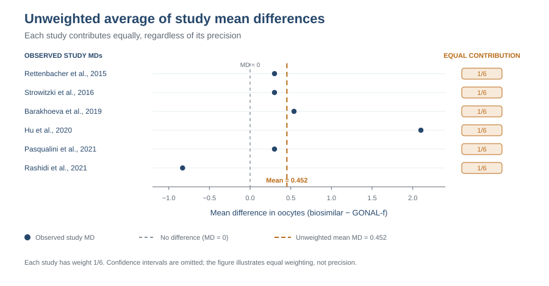
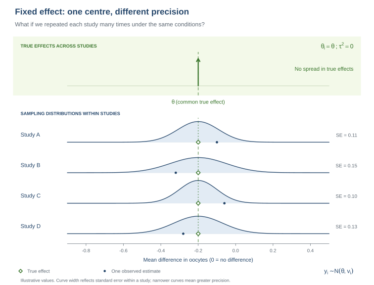

::: {.callout-note title="How to use this practical"}
Complete the R tasks and use the discussion prompts to interpret your results. The worked [solution](part2_oocytes_solution.html) is on a separate page; try these tasks first. Keep `number_oocytes_deae274.rds` in the project directory. Part 1 is available [here](part1_oocytes_task.html).
:::

# 1. Summary

In Part 1, you calculated a mean difference (MD) in the number of oocytes retrieved for each study. This practical compares an unweighted average with an inverse-variance common-effect meta-analysis. You will then inspect the forest plot, describe heterogeneity, calculate an approximate interval for a future observed study estimate, and use funnel-plot diagnostics.

The data contain six study summaries transcribed from Figure 3D. They are rounded, so calculations are approximate. The pooled MD is an average for this set of comparisons; it does not establish equivalence of the products.

# 2. Learning objectives

- Explain how an unweighted mean differs from inverse-variance pooling.
- Calculate and interpret a common-effect pooled MD and confidence interval.
- Read a forest plot and interpret Cochran's Q and I² cautiously.
- Distinguish uncertainty about a pooled mean from an interval for a future observed study estimate.
- Describe what a funnel plot, Egger's regression test, and trim-and-fill can and cannot show with few studies.

## Prepare the data

Use `metafor::escalc(measure = "MD")` to calculate each study's mean difference as the biosimilar-arm mean minus the GONAL-f mean, together with its sampling variance.

```{r}
#| warning: false
library(metafor)
library(knitr)
dat <- readRDS("number_oocytes_deae274.rds")
es <- metafor::escalc(measure = "MD",
  m1i = biosimilar_mean, sd1i = biosimilar_sd, n1i = biosimilar_n,
  m2i = originator_mean, sd2i = originator_sd, n2i = originator_n,
  data = dat)
dat$yi <- es$yi
dat$vi <- es$vi
dat$sei <- sqrt(dat$vi)
```

# 3. Unweighted average of the study mean differences

The arithmetic mean of the six study MDs gives each study equal influence, regardless of its precision:

$$\overline{MD}=\frac{1}{k}\sum_{i=1}^k MD_i.$$

An approximate standard error can be calculated from the study sampling variances, assuming independent estimates:

$$SE(\overline{MD})=\sqrt{\frac{1}{k^2}\sum_{i=1}^k v_i}.$$

This is a descriptive benchmark. It is not the same estimator as inverse-variance pooling and should not replace a meta-analysis.

{#fig-oocytes-unweighted-average-md width="100%" fig-alt="Six study mean differences are shown on a shared axis. Each study contributes one sixth to an unweighted mean of 0.452 oocytes. A grey dashed line marks zero difference and an orange dashed line marks the mean. Confidence intervals are omitted."}

**Read Figure 1:** Each dot is one observed study MD, and each study contributes $1/6$ to the arithmetic mean. The orange line marks the mean of 0.452 oocytes; the grey line marks MD = 0, or no difference between group means. Confidence intervals are omitted, so the diagram highlights equal weighting rather than study precision.

**Tasks:**

1. Calculate the unweighted mean MD and an approximate 95% confidence interval.
2. Compare it with the range of the study MDs and explain why equal weighting may be inefficient when study precision differs.

```{r}
k <- nrow(dat)
md_unweighted <- mean(dat$yi)
se_unweighted <- sqrt(sum(dat$vi)) / k
ci_unweighted <- md_unweighted + c(-1, 1) * qnorm(0.975) * se_unweighted

kable(data.frame(
  Estimate = md_unweighted,
  SE = se_unweighted,
  CI_lower = ci_unweighted[1],
  CI_upper = ci_unweighted[2],
  Minimum_study_MD = min(dat$yi),
  Maximum_study_MD = max(dat$yi)
), digits = 3, caption = "Unweighted average of study mean differences")
```

**Questions to discuss:**

1. What does the unweighted average summarize?
2. Why can it differ from a precision-weighted estimate?
3. What limits the interpretation of its approximate confidence interval?

# 4. Common-effect inverse-variance model

The common-effect model assumes that all six studies share one true MD, while their observed estimates differ because of sampling error. It assigns study $i$ the weight $w_i=1/v_i$. The pooled estimate and its standard error are

$$\hat\mu_{FE}=\frac{\sum_i w_iMD_i}{\sum_i w_i},\qquad SE(\hat\mu_{FE})=\sqrt{\frac{1}{\sum_i w_i}}.$$

The confidence interval describes uncertainty about the shared effect under this assumption. It is not an interval for the range of effects across settings.

{#fig-oocytes-fixed-effect-model width="100%" fig-alt="A common true mean difference in oocytes is shared by four hypothetical studies. Their observed estimates differ because of sampling error, and confidence intervals have different widths. The example is illustrative."}

**Read Figure 2:** The four unobserved true effects (open green diamonds) lie on the same dashed line. Observed estimates (blue dots) vary around that shared value because of sampling error (orange arrows). Horizontal bars are within-study 95% confidence intervals; their widths differ because study precision differs. On the mean-difference scale, zero represents no difference. The values in this schematic are illustrative rather than results from the six studies.

Imagine repeating each study many times under the same conditions. Its estimates would form a sampling distribution centred on the common true mean difference. The distributions share a centre but can have different widths because the studies have different standard errors:

{#fig-oocytes-fixed-effect-sampling width="100%" fig-alt="Four hypothetical sampling distributions for mean differences in oocytes share one true mean difference and have different standard errors. Green diamonds mark the common true effect and blue dots show illustrative observed estimates."}

**Read Figure 3:** The four distributions have the same centre because they share one true effect; their widths differ because their standard errors differ. Each blue dot is one possible observed estimate from a study. These distributions are a teaching illustration, not estimates from the oocyte data.

**Tasks:**

1. Fit the common-effect model with `metafor::rma()` and report its pooled MD and 95% CI.
2. Interpret the direction of the estimate and whether its interval includes zero.

```{r}
fe <- rma(yi, vi, data = dat, method = "FE", test = "z",
          slab = dat$study_label)

kable(data.frame(
  MD = as.numeric(coef(fe)), SE = fe$se,
  CI_lower = fe$ci.lb, CI_upper = fe$ci.ub
), digits = 3, caption = "Common-effect mean difference")
```

::: {.callout-note title="Optional: verify the pooled MD manually"}
Calculate inverse-variance weights and use them to check the pooled estimate and standard error from `metafor`.

```{r}
w_fe <- 1 / dat$vi
md_fe_manual <- sum(w_fe * dat$yi) / sum(w_fe)
se_fe_manual <- sqrt(1 / sum(w_fe))
c(manual_MD = md_fe_manual, metafor_MD = as.numeric(coef(fe)),
  manual_SE = se_fe_manual, metafor_SE = fe$se)
```
:::

## Forest plot

The forest plot shows each study MD and its confidence interval, together with the inverse-variance pooled result. The vertical reference at zero marks no difference in the group means.

```{r}
forest(fe, refline = 0, slab = dat$study_label,
       xlab = "Mean difference in oocytes (biosimilar − GONAL-f)",
       main = "Common-effect meta-analysis")
```

**Questions to discuss:**

1. Which study has the largest positive MD? Which has a negative MD?
2. What do the pooled estimate and its confidence interval say about the average difference under the common-effect assumption?
3. How do the study weights reflect their standard errors? What information is conveyed by the forest plot that the pooled estimate alone does not show?
4. Does the pooled result demonstrate equivalence? Why or why not?

# 5. Heterogeneity: Cochran's Q and I²

Cochran's Q compares the observed dispersion of study estimates around the common-effect estimate with the dispersion expected from their sampling variances. Under the common-effect model, Q is compared with a chi-square distribution with $k-1$ degrees of freedom.

I² describes the estimated proportion of the observed variation associated with between-study heterogeneity rather than sampling error. For this common-effect calculation,

$$Q=\sum_i w_i(MD_i-\hat\mu_{FE})^2,\qquad I^2=\max\left(0,\frac{Q-(k-1)}{Q}\right)\times100\%.$$

Neither a non-significant Q test nor a small I² proves that the true study effects are identical. With six studies, the heterogeneity assessment has limited precision.

**Main task:** Read Q, its degrees of freedom and p-value, and I² from the `metafor` output. Describe what the statistics suggest and state one limitation of that conclusion.

```{r}
kable(data.frame(
  Measure = c("Q", "Degrees of freedom", "Q p-value", "I-squared (%)"),
  Value = c(fe$QE, fe$k - 1, fe$QEp, fe$I2)
), digits = 3, caption = "metafor common-effect heterogeneity statistics")
```

::: {.callout-note title="Optional: verify Q and I² manually"}
```{r}
w_fe <- 1 / dat$vi
md_fe_manual <- sum(w_fe * dat$yi) / sum(w_fe)
Q_manual <- sum(w_fe * (dat$yi - md_fe_manual)^2)
df_Q <- nrow(dat) - 1
Q_p_manual <- pchisq(Q_manual, df = df_Q, lower.tail = FALSE)
I2_manual <- max(0, (Q_manual - df_Q) / Q_manual) * 100
c(Q = Q_manual, df = df_Q, p_value = Q_p_manual, I2_percent = I2_manual)
```
:::

**Questions to discuss:**

1. What does Q compare, and what does its value suggest relative to its degrees of freedom?
2. Why is I² not a direct measure of the absolute size of between-study differences?
3. Does a small I² establish that all studies have the same true effect?

# 6. Approximate interval for a future observed study estimate

The pooled confidence interval describes uncertainty about the shared effect under the common-effect assumption. An interval for a **future observed study estimate** also includes that study's sampling error. For this exercise, use the median observed study variance as an approximation for the future study's variance:

$$\hat\mu_{FE}\pm1.96\sqrt{\mathrm{Var}(\hat\mu_{FE})+v_{new}}.$$

This interval concerns a study-level estimate, not an individual participant's outcome. The median variance is only a proxy for a future study's precision.

**Tasks:**

1. Calculate this approximate interval using the median study variance.
2. Compare it with the common-effect confidence interval and explain why it is wider.

```{r}
v_new <- median(dat$vi)
pi_observed <- as.numeric(coef(fe)) +
  c(-1, 1) * qnorm(0.975) * sqrt(fe$se^2 + v_new)

kable(data.frame(
  Interval = c("Pooled common-effect CI", "Future observed study estimate"),
  Lower = c(fe$ci.lb, pi_observed[1]),
  Upper = c(fe$ci.ub, pi_observed[2]),
  Future_variance_used = c(NA_real_, v_new)
), digits = 3, caption = "Pooled and future-observation intervals")
```

**Questions to discuss:**

1. Which interval describes uncertainty about the shared effect and which concerns a future study estimate?
2. Why is the interval for a future estimate wider?
3. What assumption is made by using the median observed variance for a future study?

# 7. Funnel plot and small-study diagnostics

A funnel plot displays study effects against their standard errors. Apparent asymmetry can have several explanations, including chance, clinical or methodological differences, and selective publication. With six studies, visual and regression-based diagnostics have little power and should not be used to confirm or rule out publication bias.

**Tasks:**

1. Inspect the common-effect funnel plot.
2. Run Egger's regression test and trim-and-fill as descriptive sensitivity diagnostics.
3. Interpret their outputs with the small number of studies in mind.

```{r}
funnel(fe, yaxis = "sei", refline = as.numeric(coef(fe)),
       xlab = "Mean difference in oocytes", ylab = "Standard error")

egger <- regtest(fe, model = "rma")
tf <- trimfill(fe)

kable(data.frame(
  Diagnostic = c("Egger regression p-value", "Trim-and-fill estimated missing studies",
                 "Trim-and-fill adjusted MD", "Trim-and-fill CI lower",
                 "Trim-and-fill CI upper"),
  Result = c(egger$pval, tf$k0, as.numeric(coef(tf)), tf$ci.lb, tf$ci.ub)
), digits = 3, caption = "Small-study diagnostics")
funnel(tf, yaxis = "sei", xlab = "Mean difference in oocytes",
       ylab = "Standard error")
```

**Questions to discuss:**

1. What pattern do you see in the funnel plot? Could six studies establish symmetry?
2. What does the Egger test p-value tell you, and what does it not tell you?
3. Why should the trim-and-fill estimate be treated as exploratory here?
4. Does any of these diagnostics prove that publication bias is present or absent?
