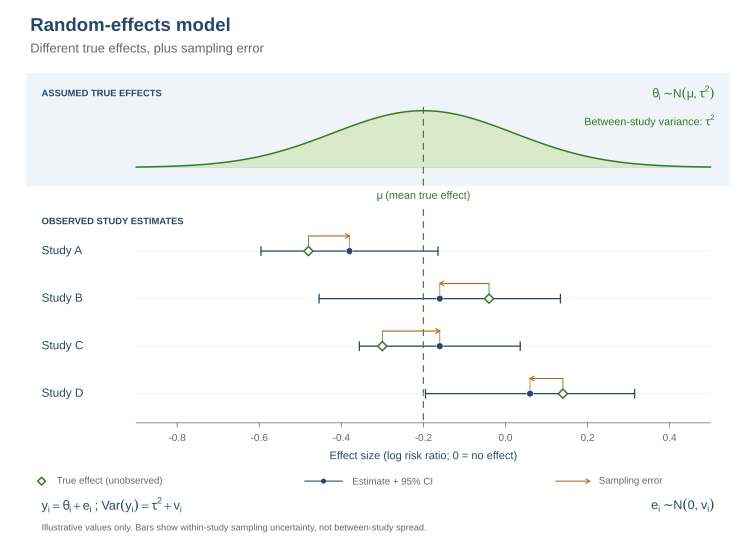
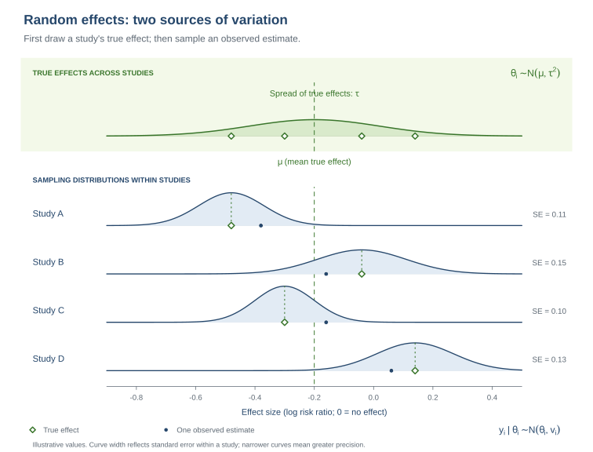

::: {.callout-note title="How to use this solution"}
The companion [task page](part3_oocytes_task.html) contains the prompts. Review each task and discussion question before reading the worked comments and answers below.
:::

# 1. Summary

In Part 2, you pooled the study mean differences under a common-effect assumption. Here, you will allow the true mean difference to vary across studies. You will fit a random-effects model, use the Knapp–Hartung (KH) method to calculate uncertainty around its average effect, examine heterogeneity, and predict effects in future settings.

The data include six study-level summaries reconstructed from a figure. Because the reported means and standard deviations are rounded, the numerical results are approximate. The small number of studies also makes the estimated heterogeneity and prediction intervals uncertain.

# 2. Learning objectives

- Explain the random-effects model's target and how it differs from the common-effect target.
- Fit a REML random-effects model and interpret its average effect and confidence interval.
- Interpret Q, I², and $\tau^2$ as related but distinct measures of heterogeneity.
- Distinguish a confidence interval for the average effect from prediction intervals for future study effects and estimates.
- Compare the results with Part 2 and use leave-one-out analysis and a funnel plot as cautious validation checks.

## Prepare the data

Use `metafor::escalc()` to calculate each study's mean difference and sampling variance. The mean difference is the biosimilar-arm mean minus the GONAL-f mean.

```{r}
#| warning: false
library(metafor)
library(knitr)
dat <- readRDS("number_oocytes_deae274.rds")
dat <- escalc(measure = "MD",
              m1i = biosimilar_mean, sd1i = biosimilar_sd, n1i = biosimilar_n,
              m2i = originator_mean, sd2i = originator_sd, n2i = originator_n,
              data = dat, append = TRUE)
dat$sei <- sqrt(dat$vi)
```

# 3. Random-effects model and Knapp–Hartung adjustment

The random-effects model allows each study to have its own true mean difference, $\theta_i$, drawn from a distribution centered on the average effect, $\mu$:

$$y_i\mid\theta_i\sim N(\theta_i,v_i),\qquad \theta_i\sim N(\mu,\tau^2).$$

Here, $y_i$ is the observed study mean difference, $v_i$ is its sampling variance, and $\tau^2$ is the between-study variance in true effects. Random-effects weights are $w_i^*=1/(v_i+\hat\tau^2)$. If $\hat\tau^2$ is positive, the weights are more similar than inverse-variance weights from Part 2, reducing the dominance of the most precise studies.

{#fig-oocyte-random-effects-model width="100%" fig-alt="A distribution of true study effects centered at mu with study-specific true effects, observed estimates, and within-study confidence intervals."}

**Figure 1:** A random-effects model has a distribution of true study mean differences around $\mu$; the observed estimates also vary because of sampling error.

**Read the diagram:** Each study has an unobserved true effect. The study estimate is centered on that effect in expectation, but sampling error makes the observed value differ. The within-study confidence interval represents sampling uncertainty; it does not show the full spread of true effects across studies.

Figure 2 separates the variation in true effects from the sampling variation around each study's true effect.

{#fig-oocyte-random-effects-sampling width="100%" fig-alt="True effects for studies are drawn around mu, and each study has a sampling distribution centered on its own true effect."}

**Figure 2:** Between-study variation in true effects and within-study sampling variation.

**Read the diagram:** Study-specific true effects need not be equal. Each sampling distribution is centered on its study's own true effect; its width represents that study's standard error.

The model below estimates $\tau^2$ using restricted maximum likelihood (REML). For this practical, we use the Knapp–Hartung (KH) method for the confidence interval around the average effect. In plain language, KH adjusts how uncertainty is calculated and uses a t distribution. It leaves the estimated average and between-study variance unchanged. We use KH throughout so you can focus on interpreting the results rather than choosing among interval methods [Partlett & Riley, 2017](#ref-partlett-riley-2017).

For readers interested in the calculation, the KH standard error in this intercept-only model is

$$SE_{KH}^2=\frac{1}{\sum_i w_i^*}\left[\frac{1}{k-1}\sum_iw_i^*(y_i-\hat\mu)^2\right].$$

The KH interval uses $k-1$ degrees of freedom. Its scale factor can make the standard error larger or smaller, so KH does not guarantee a wider interval. In this dataset, the final KH interval is wider than the conventional REML interval [Wiksten et al., 2016](#ref-wiksten-et-al-2016).

::: {.callout-note title="Other interval methods"}
KH is one of several methods used to calculate uncertainty around a random-effects average. HK2 prevents the KH variance adjustment from being smaller than the conventional REML variance. Another approach reports whichever is wider: the conventional REML interval or the ordinary KH interval [van Aert & Jackson, 2019](#ref-van-aert-jackson-2019). These are alternative methods, not extra corrections to apply together. Readers do not need to choose among them for this exercise.
:::

**Tasks:**

1. Use `metafor::rma()` to fit a common-effect model, a conventional REML random-effects model, and a REML model with KH confidence intervals.
2. Read the pooled mean difference, standard error, confidence interval, and heterogeneity estimate from the model output.
3. Compare the model estimates and 95% confidence intervals with the Part 2 common-effect result.

::: {.callout-note title="Optional: check the pooled estimate by hand"}
Use the REML estimate of $\tau^2$ to calculate the random-effects weights, pooled mean difference, and conventional standard error. This is a check on the model calculation; use the `metafor` output for the main analysis.
:::

```{r}
fe <- rma(yi, vi, data = dat, method = "FE", test = "z",
          slab = dat$study_label)
re <- rma(yi, vi, data = dat, method = "REML", test = "z",
          slab = dat$study_label)
re_kh <- rma(yi, vi, data = dat, method = "REML", test = "knha",
             slab = dat$study_label)

kable(data.frame(
  Model = c("Common effect", "Random effects (REML)",
            "Random effects (REML + KH)"),
  MD = c(as.numeric(coef(fe)), as.numeric(coef(re)), as.numeric(coef(re_kh))),
  SE = c(fe$se, re$se, re_kh$se),
  CI_lower = c(fe$ci.lb, re$ci.lb, re_kh$ci.lb),
  CI_upper = c(fe$ci.ub, re$ci.ub, re_kh$ci.ub)
), digits = 3, caption = "Pooled mean differences and 95% confidence intervals")
```

**Optional manual check:**

```{r}
w_re <- 1 / (dat$vi + re$tau2)
md_re_manual <- sum(w_re * dat$yi) / sum(w_re)
se_re_manual <- sqrt(1 / sum(w_re))

kable(data.frame(
  Quantity = c("Manual pooled MD", "REML pooled MD",
               "Manual conventional SE", "REML conventional SE"),
  Value = c(md_re_manual, as.numeric(coef(re)), se_re_manual, re$se)
), digits = 4, caption = "Optional check against the REML model")
```

**Comments on the output:** The common-effect estimate is 0.261 oocytes (95% CI −0.442 to 0.964). The random-effects model estimates an average difference of 0.292 oocytes, with a KH 95% CI from −0.693 to 1.278. In everyday terms, the estimated average is close to zero, and these studies are compatible with either a small decrease or a small increase. The interval includes zero, so this analysis does not provide a clear indication of a difference between treatments. The KH standard error (0.383) is slightly smaller than the conventional REML standard error (0.400), but KH uses a t critical value with 5 degrees of freedom rather than 1.96; that makes the final interval wider. There are only six studies, and the study estimates vary, so the result is uncertain. The optional manual calculation agrees with the conventional REML estimate and standard error.

## Forest plot

The study MDs are the same as in Part 2. The pooled diamond and study weights now come from the random-effects model, which accounts for estimated between-study variance.

```{r}
forest(re_kh, refline = 0, slab = dat$study_label,
       xlab = "Mean difference in oocytes (biosimilar − GONAL-f)",
       main = "Random-effects model with Knapp–Hartung adjustment")
```

**Forest plot comments:** The study estimates are unchanged from Part 2, but the random-effects weights account for the estimated between-study variance. The random-effects pooled MD is 0.292 oocytes, close to the common-effect estimate of 0.261. The KH confidence interval expresses the uncertainty around that average; it is wider than the conventional REML interval in this example.

**Questions to discuss:**

1. What average does the random-effects model estimate, and how does that target differ from the common-effect target?
2. How does positive $\hat\tau^2$ affect study weights?
3. What does KH change, and what does it leave unchanged?
4. What is the plain-language interpretation of the random-effects estimate and its confidence interval?
5. What does the forest plot show about the individual study estimates and their uncertainty?

::: {.callout-tip title="Answers"}

1. **What average is estimated?** The random-effects model estimates the mean of the distribution of true study MDs. The Part 2 common-effect model assumes one shared true MD for all included studies.
2. **How does positive tau-squared affect weights?** Adding the same positive amount to every study variance makes the random-effects weights more similar and reduces the dominance of the most precise studies. Here it shifts the pooled MD slightly upward.
3. **What does KH change?** KH changes how uncertainty around the average is calculated and uses a t distribution. It does not change the estimated pooled MD or REML tau-squared. Here, the KH standard error is slightly smaller than the conventional REML standard error, but the t critical value with 5 degrees of freedom is larger than 1.96, so the final KH interval is wider.
4. **How should the result be interpreted?** The random-effects estimate is an average difference of about 0.3 oocytes. Its 95% confidence interval ranges from about 0.7 fewer to 1.3 more oocytes. Because zero is within the interval, these six studies do not give a clear indication of a treatment difference; the estimate remains uncertain.
5. **What does the forest plot show?** It displays each study's mean difference and sampling interval as well as the pooled result and model-specific weights. It shows both the direction and variation of study estimates, information hidden by the pooled number alone.

:::

# 4. Heterogeneity in the random-effects analysis

Q and I² were introduced in Part 2. They remain useful, but heterogeneity is more central to the random-effects model because its estimate, $\hat\tau^2$, enters the weights and the prediction intervals. Q assesses excess dispersion, I² describes its relative extent, and $\tau^2$ estimates the absolute between-study variance on the outcome scale squared.

Compare the common-effect and REML results. Q and I² are uncertain with six studies, and a non-significant Q test does not require the REML estimate of $\tau^2$ to be exactly zero: the methods answer related but different questions.

**Tasks:**

1. Report Q, its degrees of freedom and p-value, I², and the REML estimates of $\tau^2$ and $\tau$.
2. Compare the heterogeneity results with Part 2.
3. Explain what the positive or small estimates do and do not establish about variation in true effects.

```{r}
kable(data.frame(
  Model = c("Common effect (Part 2)", "Random effects (REML)"),
  Q = c(fe$QE, re$QE),
  df = c(fe$k - 1, re$k - 1),
  Q_p = c(fe$QEp, re$QEp),
  I2_percent = c(fe$I2, re$I2),
  tau2 = c(NA_real_, re$tau2),
  tau = c(NA_real_, sqrt(re$tau2))
), digits = 3, caption = "Heterogeneity statistics by model")
```

**Comments on the output:** Q is 5.501 on 5 degrees of freedom (p = 0.358) in both rows. The common-effect I² is 9.1%; the REML estimate of tau-squared is 0.151 oocytes squared, tau is 0.389 oocytes, and the random-effects I² is 15.6%. The Q test does not detect excess dispersion, but REML estimates a modest positive variance. These are different summaries of limited data, not contradictory proof for or against heterogeneity.

**Questions to discuss:**

1. Why does $\tau^2$ matter for random-effects weights and predictions?
2. What distinct information do Q, I², and $\tau^2$ provide?
3. How can Q have a non-significant p-value while the REML estimate of $\tau^2$ is positive?
4. Does a modest $\hat\tau^2$ establish that all study effects are similar?

::: {.callout-tip title="Answers"}

1. **Why does tau-squared matter?** It represents estimated between-study variance in true MDs. It changes random-effects weights and contributes to the spread of effects predicted for a new setting.
2. **How do Q, I-squared, and tau-squared differ?** Q tests whether observed dispersion exceeds sampling error; I-squared gives a relative heterogeneity measure; tau-squared estimates the absolute variance on the outcome scale squared.
3. **Why can Q be non-significant with positive REML tau-squared?** Q is a test of excess dispersion, while REML estimates a variance component. With six studies, Q has limited power and the methods can give these results together.
4. **Does the modest estimate establish similarity?** No. It is an uncertain estimate from six rounded study summaries and cannot prove that true effects are equal or practically similar.

:::

# 5. Prediction for a future study

The KH confidence interval describes uncertainty about the average true MD. A prediction interval instead describes plausible true MDs in a future comparable setting, incorporating uncertainty in the average and estimated between-study variance. A future **observed estimate** also includes sampling error from that future study.

Use `predict()` for the model-based prediction interval for a future true effect. For the approximate interval for a future observed estimate, add the median study variance to the prediction variance. The median is a proxy for future study precision, not a known design feature.

**Tasks:**

1. Calculate the KH confidence interval for the average, the prediction interval for a future true MD, and an approximate interval for a future observed estimate.
2. Compare the three intervals with the Part 2 common-effect CI and future-observation interval.
3. Explain the source of uncertainty added at each step.

```{r}
pred <- predict(re_kh)
v_new <- median(dat$vi)
df_pi <- re_kh$k - re_kh$p
t_crit <- qt(0.975, df = df_pi)
mu_kh <- as.numeric(coef(re_kh))
se_kh <- re_kh$se
tau2_hat <- re_kh$tau2

pi_observed <- mu_kh + c(-1, 1) * t_crit *
  sqrt(se_kh^2 + tau2_hat + v_new)

kable(data.frame(
  Interval = c("KH CI for average MD", "Prediction interval: future true MD",
               "Approximate interval: future observed MD"),
  Lower = c(re_kh$ci.lb, pred$pi.lb, pi_observed[1]),
  Upper = c(re_kh$ci.ub, pred$pi.ub, pi_observed[2])
), digits = 3, caption = "Average and future-study intervals")
```

**Comments on the output:** The KH confidence interval for the average MD is −0.693 to 1.278 oocytes. The model-based prediction interval for a future true MD is −1.112 to 1.696. Adding the median observed within-study variance (0.844) gives an approximate interval for a future observed estimate of −2.455 to 3.040. Each interval targets a different quantity; the last is widest because it includes sampling error for the future study as well as uncertainty about its true effect. The median variance is only a proxy for the next study's precision.

**Questions to discuss:**

1. Which interval concerns the average effect and which concern future studies?
2. Why is the future observed-estimate interval wider than the prediction interval for a true effect?
3. What assumptions are added by using the median observed study variance?

::: {.callout-tip title="Answers"}

1. **Which interval describes which quantity?** The KH CI describes uncertainty about the mean of the true effects. The prediction interval describes a future study's true effect. The approximate observed-estimate interval also includes that future study's sampling error.
2. **Why is the observed-estimate interval wider?** It adds the future study's within-study variance on top of uncertainty about the average effect and between-study variation.
3. **What does the median variance assume?** It assumes the next study will have precision similar to the median of these six. Actual sample size and variability could make its estimate much more or less precise.

:::

# 6. Validation: influence and comparison with Part 2

Use leave-one-out analysis to assess whether one study strongly affects the pooled MD or $\hat\tau^2$. Compare the random-effects funnel plot with the Part 2 plot. These checks can identify sensitivity and unusual patterns; with six studies, neither can establish robustness or diagnose publication bias reliably.

The results can differ from Part 2 for separate reasons. Positive $\hat\tau^2$ changes the weights and can shift the pooled point estimate. KH changes uncertainty around the mean and uses a t reference distribution. Prediction intervals address future effects or estimates and therefore include uncertainty that the common-effect confidence interval does not.

**Tasks:**

1. Run a leave-one-out analysis and identify how much the pooled MD, interval, and $\tau^2$ change.
2. Draw the random-effects funnel plot and compare it with Part 2.
3. Explain which differences between Parts 2 and 3 come from the heterogeneity model, KH inference, and the prediction target.
4. State what leave-one-out analysis and a funnel plot can and cannot establish with six studies.

```{r}
loo <- leave1out(re_kh)
kable(data.frame(
  Omitted_study = dat$study_label,
  MD = loo$estimate,
  CI_lower = loo$ci.lb,
  CI_upper = loo$ci.ub,
  tau2 = loo$tau2
), digits = 3, caption = "Leave-one-out random-effects analysis")

funnel(re_kh, yaxis = "sei", refline = as.numeric(coef(re_kh)),
       xlab = "Mean difference in oocytes", ylab = "Standard error")
```

**Comments on the output:** The leave-one-out pooled MDs range from about 0.007 to 0.614 oocytes, and the REML tau-squared estimates range from 0 to 0.509. Omitting Hu et al. (2020), the most positive study, reduces the pooled estimate to about 0.007 and tau-squared to zero. Omitting Rashidi et al. (2021), the only negative study, raises it to about 0.614 and also gives tau-squared zero. Either omission changes the pooled MD by about 0.3 oocytes from the full estimate, which is sizeable relative to the full estimate of 0.292. The heterogeneity estimate is also sensitive to which study is removed. With six points, the funnel plot is only descriptive.

**Questions to discuss:**

1. Why does the random-effects pooled MD differ from the common-effect estimate here?
2. How does the KH interval differ from the conventional REML interval, and why?
3. What do the leave-one-out results say about the influence of Hu et al. and Rashidi et al.?
4. Can apparent funnel symmetry or a non-significant Part 2 Egger test prove that publication bias is absent?

::: {.callout-tip title="Answers"}

1. **Why does the random-effects MD differ from the common-effect estimate?** The REML model estimates positive between-study variance and adds it to each study variance for weighting. This reduces the relative influence of the most precise studies and shifts the pooled MD from 0.261 to 0.292.
2. **Why does the KH interval differ?** KH leaves the pooled MD unchanged but adjusts its uncertainty and uses a t reference distribution. Here the variance scale factor is below one, so the KH standard error is slightly smaller than the conventional REML standard error. The t critical value with 5 degrees of freedom is larger than 1.96, making the final KH interval wider.
3. **What do the omissions show?** Removing Hu shifts the mean toward zero; removing Rashidi shifts it upward. The estimated tau-squared reaches zero when either is removed, showing that the heterogeneity estimate is sensitive with only six studies. This is a sensitivity signal, not proof that either trial is invalid.
4. **Can the plot or Part 2 Egger test rule out publication bias?** No. A visually balanced plot or a non-significant test does not establish absence of bias, especially with so few studies. Study differences and chance can also create apparent asymmetry.

:::

# References

- <a id="ref-partlett-riley-2017"></a>Partlett, C., & Riley, R. D. (2017). Random effects meta-analysis: Coverage performance of 95% confidence and prediction intervals following REML estimation. *Statistics in Medicine, 36*(2), 301–317. [https://doi.org/10.1002/sim.7140](https://doi.org/10.1002/sim.7140)
- <a id="ref-van-aert-jackson-2019"></a>van Aert, R. C. M., & Jackson, D. (2019). A new justification of the Hartung–Knapp method for random-effects meta-analysis based on weighted least squares regression. *Research Synthesis Methods, 10*(4), 515–527. [https://doi.org/10.1002/jrsm.1356](https://doi.org/10.1002/jrsm.1356)
- <a id="ref-wiksten-et-al-2016"></a>Wiksten, A., Rücker, G., & Schwarzer, G. (2016). Hartung–Knapp method is not always conservative compared with fixed-effect meta-analysis. *Statistics in Medicine, 35*(15), 2503–2515. [https://doi.org/10.1002/sim.6879](https://doi.org/10.1002/sim.6879)
