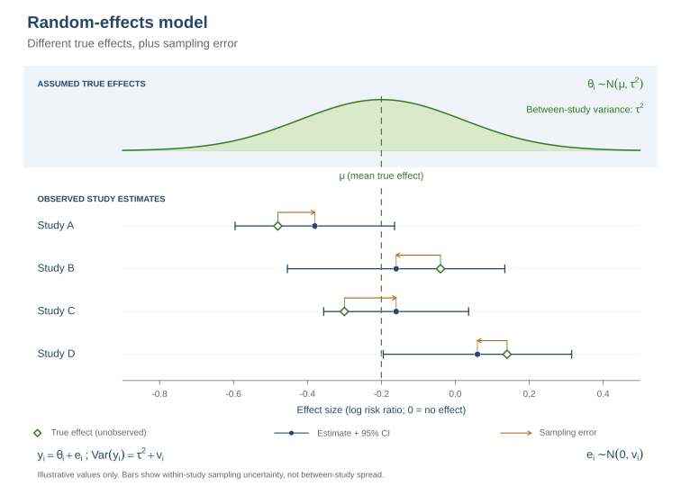
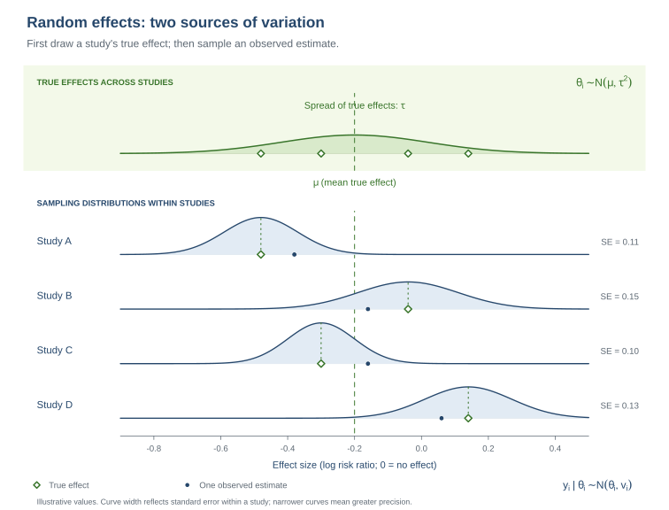

::: {.callout-note title="How to use this practical"}
Complete the R tasks and use the discussion prompts to interpret your results. The worked [solution](part3_oocytes_solution.html) is on a separate page; try these tasks first. Keep `number_oocytes_deae274.rds` in the project directory. The common-effect practical is available [here](part2_oocytes_task.html).
:::

# 1. Summary

In Part 2, you pooled the study mean differences under a common-effect assumption. Here, you will allow the true mean difference to vary across studies. You will fit a random-effects model, use the Knapp–Hartung (KH) adjustment for uncertainty in the average effect, examine heterogeneity, and predict effects in future settings.

The data include six study-level summaries reconstructed from a figure. Because the reported means and standard deviations are rounded, the numerical results are approximate. The small number of studies also makes the estimated heterogeneity and prediction intervals uncertain.

# 2. Learning objectives

- Explain the random-effects model's target and how it differs from the common-effect target.
- Fit a REML random-effects model with Knapp–Hartung (KH) confidence intervals using `metafor`.
- Interpret Q, I², and $\tau^2$ as related but distinct measures of heterogeneity.
- Distinguish a confidence interval for the average effect from prediction intervals for future study effects and estimates.
- Compare the results with Part 2 and use leave-one-out analysis and a funnel plot as cautious validation checks.

## Prepare the data

Use `metafor::escalc()` to calculate each study's mean difference and sampling variance. The mean difference is the biosimilar-arm mean minus the GONAL-f mean.

```{r}
#| warning: false
library(metafor)
library(knitr)
dat <- readRDS("number_oocytes_deae274.rds")
dat <- escalc(measure = "MD",
              m1i = biosimilar_mean, sd1i = biosimilar_sd, n1i = biosimilar_n,
              m2i = originator_mean, sd2i = originator_sd, n2i = originator_n,
              data = dat, append = TRUE)
dat$sei <- sqrt(dat$vi)
```

# 3. Random-effects model and Knapp–Hartung adjustment

The random-effects model allows each study to have its own true mean difference, $\theta_i$, drawn from a distribution centered on the average effect, $\mu$:

$$y_i\mid\theta_i\sim N(\theta_i,v_i),\qquad \theta_i\sim N(\mu,\tau^2).$$

Here, $y_i$ is the observed study mean difference, $v_i$ is its sampling variance, and $\tau^2$ is the between-study variance in true effects. Random-effects weights are $w_i^*=1/(v_i+\hat\tau^2)$. If $\hat\tau^2$ is positive, the weights are more similar than inverse-variance weights from Part 2, reducing the dominance of the most precise studies.

{#fig-oocyte-random-effects-model width="100%" fig-alt="A distribution of true study effects centered at mu with study-specific true effects, observed estimates, and within-study confidence intervals."}

**Figure 1:** A random-effects model has a distribution of true study mean differences around $\mu$; the observed estimates also vary because of sampling error.

**Read the diagram:** Each study has an unobserved true effect. The study estimate is centered on that effect in expectation, but sampling error makes the observed value differ. The within-study confidence interval represents sampling uncertainty; it does not show the full spread of true effects across studies.

Figure 2 separates the variation in true effects from the sampling variation around each study's true effect.

{#fig-oocyte-random-effects-sampling width="100%" fig-alt="True effects for studies are drawn around mu, and each study has a sampling distribution centered on its own true effect."}

**Figure 2:** Between-study variation in true effects and within-study sampling variation.

**Read the diagram:** Study-specific true effects need not be equal. Each sampling distribution is centered on its study's own true effect; its width represents that study's standard error.

The model below estimates $\tau^2$ using restricted maximum likelihood (REML). For this practical, use the Knapp–Hartung (KH) method for the confidence interval around the average effect. KH adjusts how uncertainty is calculated and uses a t distribution. It leaves the estimated average and between-study variance unchanged. We use KH throughout so you can focus on interpreting the results rather than choosing among interval methods [Partlett & Riley, 2017](#ref-partlett-riley-2017).

For readers interested in the calculation, the KH variance for this intercept-only model is

$$SE_{KH}^2=\frac{1}{\sum_i w_i^*}\left[\frac{1}{k-1}\sum_iw_i^*(y_i-\hat\mu)^2\right].$$

The KH interval uses $k-1$ degrees of freedom. Its scale factor can make the standard error larger or smaller, so KH does not guarantee a wider interval. In this dataset, the final KH interval is wider than the conventional REML interval [Wiksten et al., 2016](#ref-wiksten-et-al-2016).

**Tasks:**

1. Use `metafor::rma()` to fit a common-effect model, a conventional REML random-effects model, and a REML model with KH confidence intervals.
2. Read the pooled mean difference, standard error, confidence interval, and heterogeneity estimate from the model output.
3. Compare the model estimates and 95% confidence intervals with the Part 2 common-effect result.

::: {.callout-note title="Optional: check the pooled estimate by hand"}
Use the REML estimate of $\tau^2$ to calculate the random-effects weights, pooled mean difference, and conventional standard error. This is a check on the model calculation; use the `metafor` output for the main analysis.
:::

```{r}
fe <- rma(yi, vi, data = dat, method = "FE", test = "z",
          slab = dat$study_label)
re <- rma(yi, vi, data = dat, method = "REML", test = "z",
          slab = dat$study_label)
re_kh <- rma(yi, vi, data = dat, method = "REML", test = "knha",
             slab = dat$study_label)

kable(data.frame(
  Model = c("Common effect", "Random effects (REML)",
            "Random effects (REML + KH)"),
  MD = c(as.numeric(coef(fe)), as.numeric(coef(re)), as.numeric(coef(re_kh))),
  SE = c(fe$se, re$se, re_kh$se),
  CI_lower = c(fe$ci.lb, re$ci.lb, re_kh$ci.lb),
  CI_upper = c(fe$ci.ub, re$ci.ub, re_kh$ci.ub)
), digits = 3, caption = "Pooled mean differences and 95% confidence intervals")
```

**Optional manual check:**

```{r}
w_re <- 1 / (dat$vi + re$tau2)
md_re_manual <- sum(w_re * dat$yi) / sum(w_re)
se_re_manual <- sqrt(1 / sum(w_re))

kable(data.frame(
  Quantity = c("Manual pooled MD", "REML pooled MD",
               "Manual conventional SE", "REML conventional SE"),
  Value = c(md_re_manual, as.numeric(coef(re)), se_re_manual, re$se)
), digits = 4, caption = "Optional check against the REML model")
```

## Forest plot

The study MDs are the same as in Part 2. The pooled diamond and study weights now come from the random-effects model, which accounts for estimated between-study variance.

```{r}
forest(re_kh, refline = 0, slab = dat$study_label,
       xlab = "Mean difference in oocytes (biosimilar − GONAL-f)",
       main = "Random-effects model with Knapp–Hartung adjustment")
```

**Questions to discuss:**

1. What average does the random-effects model estimate, and how does that target differ from the common-effect target?
2. How does positive $\hat\tau^2$ affect study weights?
3. What does the KH adjustment change, and why might its interval differ from the conventional REML interval?
4. Compare the three pooled estimates and intervals. What changes when the model allows between-study variation, and what changes when KH is used?
5. What does the forest plot show about the individual study estimates and their uncertainty?

# 4. Heterogeneity in the random-effects analysis

Q and I² were introduced in Part 2. They remain useful, but heterogeneity is more central to the random-effects model because its estimate, $\hat\tau^2$, enters the weights and the prediction intervals. Q assesses excess dispersion, I² describes its relative extent, and $\tau^2$ estimates the absolute between-study variance on the outcome scale squared.

Compare the common-effect and REML results. Q and I² are uncertain with six studies, and a non-significant Q test does not require the REML estimate of $\tau^2$ to be exactly zero: the methods answer related but different questions.

**Tasks:**

1. Report Q, its degrees of freedom and p-value, I², and the REML estimates of $\tau^2$ and $\tau$.
2. Compare the heterogeneity results with Part 2.
3. Explain what the positive or small estimates do and do not establish about variation in true effects.

```{r}
kable(data.frame(
  Model = c("Common effect (Part 2)", "Random effects (REML)"),
  Q = c(fe$QE, re$QE),
  df = c(fe$k - 1, re$k - 1),
  Q_p = c(fe$QEp, re$QEp),
  I2_percent = c(fe$I2, re$I2),
  tau2 = c(NA_real_, re$tau2),
  tau = c(NA_real_, sqrt(re$tau2))
), digits = 3, caption = "Heterogeneity statistics by model")
```

**Questions to discuss:**

1. Why does $\tau^2$ matter for random-effects weights and predictions?
2. What distinct information do Q, I², and $\tau^2$ provide?
3. How can Q have a non-significant p-value while the REML estimate of $\tau^2$ is positive?
4. Does a modest $\hat\tau^2$ establish that all study effects are similar?

# 5. Prediction for a future study

The KH confidence interval describes uncertainty about the average true MD. A prediction interval instead describes plausible true MDs in a future comparable setting, incorporating uncertainty in the average and estimated between-study variance. A future **observed estimate** also includes sampling error from that future study.

Use `predict()` for the model-based prediction interval for a future true effect. For the approximate interval for a future observed estimate, add the median study variance to the prediction variance. The median is a proxy for future study precision, not a known design feature.

**Tasks:**

1. Calculate the KH confidence interval for the average, the prediction interval for a future true MD, and an approximate interval for a future observed estimate.
2. Compare the three intervals with the Part 2 common-effect CI and future-observation interval.
3. Explain the source of uncertainty added at each step.

```{r}
pred <- predict(re_kh)
v_new <- median(dat$vi)
df_pi <- re_kh$k - re_kh$p
t_crit <- qt(0.975, df = df_pi)
mu_kh <- as.numeric(coef(re_kh))
se_kh <- re_kh$se
tau2_hat <- re_kh$tau2

pi_observed <- mu_kh + c(-1, 1) * t_crit *
  sqrt(se_kh^2 + tau2_hat + v_new)

kable(data.frame(
  Interval = c("KH CI for average MD", "Prediction interval: future true MD",
               "Approximate interval: future observed MD"),
  Lower = c(re_kh$ci.lb, pred$pi.lb, pi_observed[1]),
  Upper = c(re_kh$ci.ub, pred$pi.ub, pi_observed[2])
), digits = 3, caption = "Average and future-study intervals")
```

**Questions to discuss:**

1. Which interval concerns the average effect and which concern future studies?
2. Why is the future observed-estimate interval wider than the prediction interval for a true effect?
3. What assumptions are added by using the median observed study variance?

# 6. Validation: influence and comparison with Part 2

Use leave-one-out analysis to assess whether one study strongly affects the pooled MD or $\hat\tau^2$. Compare the random-effects funnel plot with the Part 2 plot. These checks can identify sensitivity and unusual patterns; with six studies, neither can establish robustness or diagnose publication bias reliably.

The results can differ from Part 2 for separate reasons. Positive $\hat\tau^2$ changes the weights and can shift the pooled point estimate. KH changes uncertainty around the mean and uses a t reference distribution. Prediction intervals address future effects or estimates and therefore include uncertainty that the common-effect confidence interval does not.

**Tasks:**

1. Run a leave-one-out analysis and identify how much the pooled MD, interval, and $\tau^2$ change.
2. Draw the random-effects funnel plot and compare it with Part 2.
3. Explain which differences between Parts 2 and 3 come from the heterogeneity model, KH inference, and the prediction target.
4. State what leave-one-out analysis and a funnel plot can and cannot establish with six studies.

```{r}
loo <- leave1out(re_kh)
kable(data.frame(
  Omitted_study = dat$study_label,
  MD = loo$estimate,
  CI_lower = loo$ci.lb,
  CI_upper = loo$ci.ub,
  tau2 = loo$tau2
), digits = 3, caption = "Leave-one-out random-effects analysis")

funnel(re_kh, yaxis = "sei", refline = as.numeric(coef(re_kh)),
       xlab = "Mean difference in oocytes", ylab = "Standard error")
```

**Questions to discuss:**

1. Why does the random-effects pooled MD differ from the common-effect estimate here?
2. How does the KH interval differ from the conventional REML interval, and why?
3. What do the leave-one-out results say about the influence of Hu et al. and Rashidi et al.?
4. Can apparent funnel symmetry or a non-significant Part 2 Egger test prove that publication bias is absent?

# References

- <a id="ref-partlett-riley-2017"></a>Partlett, C., & Riley, R. D. (2017). Random effects meta-analysis: Coverage performance of 95% confidence and prediction intervals following REML estimation. *Statistics in Medicine, 36*(2), 301–317. [https://doi.org/10.1002/sim.7140](https://doi.org/10.1002/sim.7140)
- <a id="ref-wiksten-et-al-2016"></a>Wiksten, A., Rücker, G., & Schwarzer, G. (2016). Hartung–Knapp method is not always conservative compared with fixed-effect meta-analysis. *Statistics in Medicine, 35*(15), 2503–2515. [https://doi.org/10.1002/sim.6879](https://doi.org/10.1002/sim.6879)
