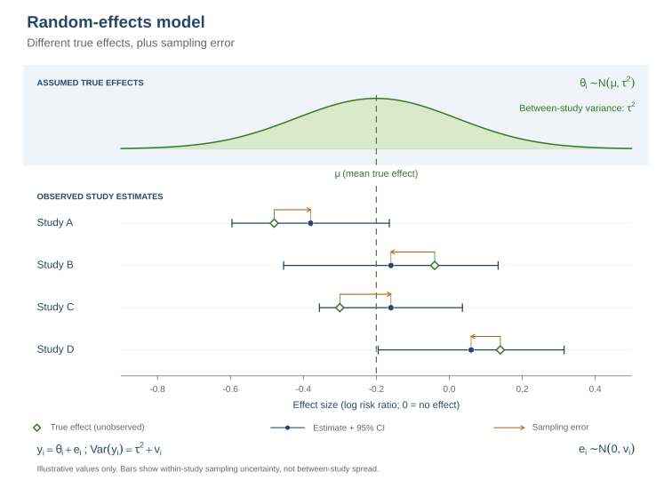
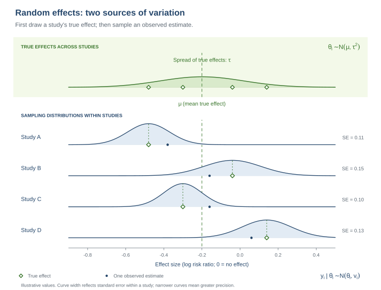

::: {.callout-note title="How to use this solution"}
This page follows the companion [task page](part3_random_effects_task.html). It includes the same explanations, figures, tasks, and discussion prompts, followed by worked comments and answers.
:::

# 1. Summary

In Part 2, you pooled the study risk ratios under a common-effect model. This practical extends that analysis by allowing the true log risk ratio to vary across studies. You will estimate the average true effect, examine how the estimated between-study variation affects the results, and compare the pooled estimates and predictions with those from Part 2. The dataset contains seven studies, so estimates of between-study variation will be uncertain.

# 2. Learning objectives

- Explain how a random-effects model differs from the common-effect model in Part 2.
- Fit a REML random-effects model and interpret its Knapp–Hartung (KH) confidence interval.
- Compare random-effects estimates and confidence intervals with the Part 2 results.
- Interpret $\tau^2$, Q, and I² in the context of a random-effects analysis.
- Distinguish a confidence interval for the mean effect from prediction intervals for a future true effect and a future observed estimate.
- Use leave-one-out results and a funnel plot to assess how sensitive the analysis is to individual studies and model choice.

## Prepare the data

Run this setup once before starting the analyses. It calculates each study’s risk ratio as the ongoing-pregnancy risk in the biosimilar arm divided by the risk in the GONAL-f arm, then uses `metafor::escalc()` to obtain its log RR and sampling variance.

```{r}
#| warning: false
library(metafor)
library(knitr)
dat <- readRDS("ongoing_pregnancy_deae274.rds")
dat$risk_b <- dat$biosimilar_events / dat$biosimilar_total
dat$risk_o <- dat$originator_events / dat$originator_total
es <- metafor::escalc(measure = "RR", ai = biosimilar_events,
  bi = biosimilar_total - biosimilar_events, ci = originator_events,
  di = originator_total - originator_events, data = dat)
dat$rr <- dat$risk_b / dat$risk_o
dat$yi <- es$yi
dat$vi <- es$vi
dat$sei <- sqrt(dat$vi)
```

# 3. Random-effects model and Knapp–Hartung adjustment

The common-effect model in Part 2 assumes one true log RR for all studies. A random-effects model instead assumes that study-specific true log RRs vary around an average, $\mu$:

$$y_i\mid\theta_i\sim N(\theta_i,v_i),\qquad \theta_i\sim N(\mu,\tau^2).$$

The model has two sources of variation: true effects can differ across studies, and each study’s observed estimate can differ from its own true effect because of sampling error.

{#fig-random-effects-model width="100%" fig-alt="A distribution of true study effects centered at mu with between-study variance tau squared. Four studies have different true effects and observed estimates, with within-study confidence intervals and arrows showing sampling error from each true effect to its observed estimate."}

**Figure 1:** Random-effects model. True effects vary around the mean effect $\mu$; observed estimates also vary because of within-study sampling error.

**Read the diagram:** The green curve represents the distribution of true effects across studies, centered at $\mu$. Each green diamond marks one study’s true effect, which is unobserved. The blue dot is that study’s observed estimate; the orange arrow shows its sampling error. The horizontal confidence interval shows within-study uncertainty, not the spread of true effects across studies.

Figure 2 separates these two sources of variation. Each study has its own true effect drawn from the distribution above, and its sampling distribution is centered on that study-specific true effect. The widths of the sampling distributions reflect the studies’ different standard errors.

{#fig-random-effects-sampling width="100%" fig-alt="True effects for four studies are drawn from a distribution centered at mu. Below, each study has a sampling distribution centered at its own true effect, with a different width reflecting its standard error; one observed estimate is marked in each distribution."}

**Figure 2:** Two sources of variation: between-study differences in true effects and within-study sampling variation around each true effect.

**Read the diagram:** The green diamonds in the upper panel represent study-specific true effects around $\mu$. In the lower panel, each curve is the sampling distribution for one study, centered on its own true effect; the blue dot marks one possible observed estimate. Narrower curves indicate smaller standard errors and greater precision. The study distributions do not all share the same centre, as they do under the common-effect model in Part 2.

Here, $\tau^2$ is the between-study variance on the log-RR scale. The model estimates this variance (here by restricted maximum likelihood, REML) and uses weights $w_i^*=1/(v_i+\hat\tau^2)$ to estimate the average effect. When $\hat\tau^2$ is greater than zero, the added variance reduces the dominance of the most precise studies compared with fixed-effect weighting.

For this practical, we use the Knapp–Hartung (KH) method to calculate the confidence interval around the random-effects average. KH adjusts the estimated uncertainty and uses a t distribution, which is useful to consider when the number of studies is small. It does not change the estimated average effect. We use KH throughout this practical so that you can focus on interpreting the results rather than choosing among interval methods [Partlett & Riley, 2017](#ref-partlett-riley-2017).

For readers interested in the calculation, the KH variance in this intercept-only model is

$$SE_{KH}^2=\frac{1}{\sum_i w_i^*}\left[\frac{1}{k-1}\sum_iw_i^*(y_i-\hat\mu)^2\right],$$

The KH interval uses $k-1$ degrees of freedom. KH does not guarantee a wider interval: its scale factor can make the standard error larger or smaller. This is one reason to name the interval method used and interpret the results in context.

::: {.callout-note title="Other methods (optional)"}
Researchers also use alternatives such as HK2 and a rule that reports whichever is wider: the conventional REML or ordinary KH interval [van Aert & Jackson, 2019](#ref-van-aert-jackson-2019). These are competing ways to calculate uncertainty around the same random-effects average. They are not additional corrections to apply together, and you do not need to calculate or choose among them in this practical. The KH interval can be narrower than the conventional interval in some datasets [Wiksten et al., 2016](#ref-wiksten-et-al-2016). The common-effect result from Part 2 is a separate model for comparison.
:::

**Tasks:**

1. Fit a common-effect model and a REML random-effects model with KH confidence intervals.
2. Read the pooled log RR, standard error, confidence interval, and heterogeneity estimate from the `metafor` output.
3. Compare the common-effect and random-effects results. Focus on what changes in the pooled estimate and what changes in its uncertainty.

::: {.callout-note title="Optional: check the pooled estimate manually"}
Use the REML estimate of $\tau^2$ to calculate the random-effects weights, pooled log RR, and conventional standard error. This is an optional check on the model calculation.
:::

```{r}
fe <- rma(yi, vi, data = dat, method = "FE", test = "z", slab = study_label)
re <- rma(yi, vi, data = dat, method = "REML", test = "z", slab = study_label)
re_kh <- rma(yi, vi, data = dat, method = "REML", test = "knha",
             slab = study_label)

kable(data.frame(
  Model = c("Common effect", "Random effects (REML)", "Random effects (REML + KH)"),
  RR = exp(c(as.numeric(coef(fe)), as.numeric(coef(re)), as.numeric(coef(re_kh)))),
  SE_log_RR = c(fe$se, re$se, re_kh$se),
  CI_lower = exp(c(fe$ci.lb, re$ci.lb, re_kh$ci.lb)),
  CI_upper = exp(c(fe$ci.ub, re$ci.ub, re_kh$ci.ub)),
  tau2 = c(NA_real_, re$tau2, re_kh$tau2)
), digits = 3, caption = "Pooled risk ratios and 95% confidence intervals")
```

```{r}
w_re <- 1 / (dat$vi + re$tau2)
mu_re_manual <- sum(w_re * dat$yi) / sum(w_re)
var_mu_re_manual <- 1 / sum(w_re)
se_mu_re_manual <- sqrt(var_mu_re_manual)
kable(data.frame(
  Quantity = c("Manual pooled log RR", "REML pooled log RR",
               "Manual conventional SE", "REML conventional SE"),
  Value = c(mu_re_manual, as.numeric(coef(re)), se_mu_re_manual, re$se)
), digits = 4, caption = "Optional manual check")
```

**Comments on the output:** REML estimates $\hat\tau^2=0$, so the conventional random-effects estimate and interval match the common-effect result: RR 0.810 (95% CI 0.701 to 0.935). KH gives the same pooled RR but a narrower interval (0.733 to 0.894) in this dataset. This is a useful reminder that KH is an uncertainty method, not a guarantee that the interval will be wider. Both intervals are entirely below 1, so the pooled estimates suggest a lower ongoing-pregnancy risk in the biosimilar arms than in the GONAL-f arms. Interpret this cautiously: the analysis combines only seven studies of several biosimilar products, and a zero estimate of between-study variance does not prove that all products have the same effect or that no heterogeneity exists. The optional manual calculation gives the same conventional pooled estimate and standard error as REML.

## Forest plot

The random-effects forest plot uses the same study estimates as in Part 2, but summarizes them with the random-effects model. Study weights now depend on both within-study variance and the estimated between-study variance.

```{r}
forest(re_kh, atransf = exp, refline = 0, slab = dat$study_label,
       xlab = "Risk ratio (biosimilar / GONAL-f)",
       main = "Random-effects model with Knapp–Hartung adjustment")
```

**Forest plot comments:** The squares show the study RRs and their relative random-effects weights; the diamond shows the pooled estimate and its confidence interval. With $\hat\tau^2=0$, the conventional random-effects point estimate coincides with the Part 2 common-effect estimate. The KH adjustment changes the uncertainty interval, not the pooled point estimate.

**Questions to discuss:**

1. What average does the random-effects model estimate, and how does that target differ from the common-effect estimate in Part 2?
2. How does adding $\hat\tau^2$ to the study variances affect the weights when $\hat\tau^2>0$?
3. What does the KH adjustment change? Why can its confidence interval differ from the conventional REML interval even when the pooled RR is the same?
4. Compare the three pooled RRs and confidence intervals. What does the KH interval add to the interpretation?
5. In the forest plot, identify the study estimates, their relative weights, and the pooled estimate. How does its pooled result compare with the Part 2 forest plot?


::: {.callout-tip title="Answers"}

1. **What average does the random-effects model estimate?** It estimates the mean of the distribution of true study log RRs. The Part 2 common-effect model estimates one shared true log RR.
2. **How does $\hat\tau^2$ affect the weights?** Adding it to each study’s variance makes the weights more similar, so the most precise studies have less dominance when $\hat\tau^2>0$. Here, $\hat\tau^2=0$, so the REML weights reduce to the common-effect weights.
3. **What does KH change?** KH adjusts uncertainty and uses a t distribution. It does not change the pooled RR or REML estimate of $\tau^2$. Its interval can be wider or narrower than the conventional REML interval; here it is narrower.
4. **How do the model results compare?** The common-effect and conventional REML estimates and intervals coincide because $\hat\tau^2=0$ (RR 0.810, 95% CI 0.701 to 0.935). KH has the same point estimate and a narrower interval (0.733 to 0.894). Both intervals are below 1, so the pooled estimates suggest lower ongoing-pregnancy risk in the biosimilar arms. This result is limited to these seven studies and the products they evaluated; it does not establish that every biosimilar has the same effect. The estimate of $\hat\tau^2=0$ should not be taken as proof that study effects are identical.
5. **How does the forest plot compare with Part 2?** It shows the same study estimates, with random-effects weights. Because $\hat\tau^2=0$, the conventional pooled estimate is unchanged. Overlapping study CIs still do not establish that true effects are identical.

:::

# 4. Heterogeneity in the random-effects analysis

Part 2 defines and calculates Q and I²; refer back to that section for their interpretation. They play a more central role here because the random-effects model allows true effects to vary. The estimated $\tau^2$ adds variance to the model weights and contributes to prediction intervals. Q and I² provide evidence about heterogeneity and its relative extent, while $\tau^2$ gives its estimated absolute size on the log-RR scale. With only seven studies, all three measures are uncertain, and Q may have limited power to detect heterogeneity.

Compare the heterogeneity statistics from the common-effect and REML models. In particular, consider whether the data show evidence of excess dispersion and how much confidence to place in a zero estimate of $\tau^2$ with only seven studies.

**Tasks:**

1. Report Q, its degrees of freedom and p-value, I², and the REML estimates of $\tau^2$ and $\tau$.
2. Compare Q and I² with the Part 2 results. Explain how they relate to the REML estimate of $\tau^2$ in this dataset.
3. State what the heterogeneity results do and do not allow you to conclude about differences in true effects across studies.

```{r}
kable(data.frame(
  Model = c("Common effect (Part 2)", "Random effects (REML)"),
  Q = c(fe$QE, re$QE),
  df = c(fe$k - 1, re$k - 1),
  Q_p = c(fe$QEp, re$QEp),
  I2_percent = c(fe$I2, re$I2),
  tau2 = c(NA_real_, re$tau2),
  tau = c(NA_real_, sqrt(re$tau2))
), digits = 3, caption = "Heterogeneity statistics by model")
```

**Comments on the output:** The estimated between-study variance and standard deviation are both zero. The common-effect and REML rows also report Q = 1.816 on 6 degrees of freedom (p = 0.936) and I² = 0%. These statistics do not indicate excess dispersion in this dataset. A zero estimate from seven studies is uncertain and does not establish that the true effects are identical.

**Questions to discuss:**

1. Why is between-study variation especially important when interpreting a random-effects model?
2. How do Q, I², and $\tau^2$ contribute different information about heterogeneity?
3. If the estimated $\tau^2$ is zero, does that prove all study effects are identical? How does the small number of studies affect your answer?


::: {.callout-tip title="Answers"}

1. **Why is heterogeneity important here?** The random-effects model permits true effects to vary; the estimated $\tau^2$ changes the study weights and contributes to prediction intervals. Q and I² help describe evidence and relative extent, while $\tau^2$ gives the estimated absolute spread on the log-RR scale.
2. **How do Q, I², and $\tau^2$ differ?** Q assesses excess dispersion, I² describes its relative extent, and $\tau^2$ estimates the absolute between-study variance. They answer related but different questions.
3. **Does $\hat\tau^2=0$ prove identical effects?** No. It is the estimate for these data, not proof that heterogeneity is absent. With only seven studies, modest variation could be missed.

:::

# 5. Prediction for a future study

Part 2 estimated an interval for a future **observed** study estimate under the common-effect assumption. The random-effects model also allows the true effect in a future setting to differ from the average. A prediction interval for that true effect combines uncertainty in the estimated average with the estimated between-study variance. An interval for a future observed estimate also includes that study’s sampling variance.

For this exercise, use the KH standard error for the pooled mean, a t critical value with $k-2$ degrees of freedom, and the median observed within-study variance as a stand-in for a future study’s variance:

$$\text{Future true effect: }\hat\mu\pm t_{k-2,0.975}\sqrt{SE_{KH}^2+\hat\tau^2}$$

$$\text{Future observed estimate: }\hat\mu\pm t_{k-2,0.975}\sqrt{SE_{KH}^2+\hat\tau^2+v_{new}}.$$

These are approximate intervals. The median variance is only a proxy for the precision of a future study.

**Tasks:**

1. Calculate the KH confidence interval for the average effect, the prediction interval for a future true effect, and the interval for a future observed estimate.
2. Report the limits on the RR scale and compare them with the Part 2 intervals.
3. Explain which sources of uncertainty are included in each interval and why the intervals differ.

```{r}
k <- nrow(dat)
t_crit <- qt(0.975, df = k - 2)
v_new <- median(dat$vi)
mu_kh <- as.numeric(coef(re_kh))
se_mu_kh <- re_kh$se
tau2_kh <- re_kh$tau2

pi_true <- exp(mu_kh + c(-1, 1) * t_crit *
                 sqrt(se_mu_kh^2 + tau2_kh))
pi_observed <- exp(mu_kh + c(-1, 1) * t_crit *
                     sqrt(se_mu_kh^2 + tau2_kh + v_new))

kable(data.frame(
  Interval = c("KH pooled CI", "Future true effect", "Future observed estimate"),
  Lower = c(exp(re_kh$ci.lb), pi_true[1], pi_observed[1]),
  Upper = c(exp(re_kh$ci.ub), pi_true[2], pi_observed[2])
), digits = 3, caption = "Pooled and future-study intervals")
```

**Comments on the output:** The KH pooled CI is RR 0.733 to 0.894. The approximate interval for a future true effect is RR 0.729 to 0.898, and the interval for a future observed estimate is RR 0.509 to 1.287. Since $\hat\tau^2=0$, the future true-effect interval adds no estimated between-study spread; the future observed-estimate interval is wider because it also includes the new study’s sampling variance.

**Questions to discuss:**

1. Which interval describes uncertainty about the average effect, and which intervals concern future studies?
2. Why is the future observed-estimate interval wider than the interval for a future true effect?
3. What assumptions are introduced by using the median study variance and a normal or t approximation?


::: {.callout-tip title="Answers"}

1. **Which intervals concern the average and future studies?** The KH pooled CI describes uncertainty about the average effect. The future true-effect interval describes plausible true effects in a comparable setting, and the future observed-estimate interval also includes the future study’s sampling error.
2. **Why is the observed-estimate interval wider?** It adds the future study’s within-study sampling variance to the uncertainty about its true effect.
3. **What assumptions are used?** The calculations use the random-effects model, the KH standard error, a t approximation, and the median observed study variance as a proxy for the future study’s variance. The proxy may not represent the precision of the next study.

:::

# 6. Validation: influence and comparison with Part 2

Use the leave-one-out analysis to see whether removing a single study materially changes the pooled RR, its interval, or the estimated $\tau^2$. Then compare the random-effects funnel plot with the Part 2 plot. As in Part 2, the plot is a descriptive diagnostic; changes in its centre or limits can reflect the fitted model and weighting and do not by themselves identify a cause.

The results may differ from Part 2 for distinct reasons. If $\hat\tau^2>0$, random-effects weights include between-study variance and the pooled estimate can shift toward studies that had less influence under fixed-effect weighting. When $\hat\tau^2=0$, conventional REML weights and the pooled point estimate coincide with the common-effect results. KH can still change the confidence interval because it adjusts uncertainty separately. Prediction intervals can also differ because the random-effects calculations include $\hat\tau^2$ and use the KH-based uncertainty and t critical value.

**Tasks:**

1. Run the leave-one-out analysis. Identify whether any one study has a marked effect on the pooled RR, interval, or $\tau^2$.
2. Draw the random-effects funnel plot and compare its centre and shape with the Part 2 plot.
3. Using your model table and prediction intervals, explain why the random-effects results do or do not differ from the common-effect results in this dataset. Separate the effect of $\hat\tau^2$ from the effect of KH.
4. State what the leave-one-out analysis and funnel plot can help you assess, and what they cannot establish with seven studies.

```{r}
loo <- leave1out(re_kh)
kable(data.frame(
  Omitted_study = dat$study_label,
  RR = exp(loo$estimate),
  CI_lower = exp(loo$ci.lb),
  CI_upper = exp(loo$ci.ub),
  tau2 = loo$tau2
), digits = 3, caption = "Leave-one-out random-effects analysis")

funnel(re_kh, yaxis = "sei", refline = as.numeric(coef(re_kh)),
       xlab = "Log risk ratio", ylab = "Standard error")
```

**Comments on the output:** The leave-one-out pooled RRs range from 0.796 to 0.818, and the REML estimate of $\tau^2$ remains zero for every omission. Removing Pasqualini et al. (2021) produces the lowest RR (0.796); omitting any of the other studies changes the estimate only slightly. The random-effects funnel plot remains a small-sample diagnostic and cannot determine why the points have their observed pattern.

**Questions to discuss:**

1. Why might the REML point estimate and conventional confidence interval match Part 2 here, while the KH interval differs?
2. If $\hat\tau^2$ is zero, what does that imply for the random-effects weights and the future true-effect interval? What does it not imply?
3. How can the weighting model and uncertainty method affect a funnel plot’s reference line or limits?
4. What do the leave-one-out results suggest about sensitivity to individual studies? Can either diagnostic prove that the findings are robust or that publication bias is absent?


::: {.callout-tip title="Answers"}

1. **Why do some results match Part 2 while the KH interval differs?** With $\hat\tau^2=0$, conventional REML uses the same weights and produces the same pooled estimate and normal-theory CI as the common-effect model. KH separately adjusts uncertainty; here its residual scale factor yields a narrower interval.
2. **What does zero $\hat\tau^2$ imply?** The random-effects weights reduce to inverse within-study variances, and the prediction interval adds no estimated between-study component. It does not prove the true effects are identical or that heterogeneity is absent.
3. **Why might the funnel plot differ?** Its reference line and pseudo-confidence limits depend on the fitted mean and the model’s variance assumptions. Here the pooled means coincide and $\hat\tau^2=0$, so the random-effects plot should be similar to Part 2; with positive $\hat\tau^2$, its limits could differ.
4. **What do the diagnostics suggest?** Omitting Pasqualini et al. shifts the pooled RR most (to 0.796), while the other omissions have smaller effects and all leave-one-out $\hat\tau^2$ estimates remain zero. These checks do not prove robustness, rule out missed heterogeneity, or establish the presence or absence of publication bias, especially with seven studies.

:::

# References

- <a id="ref-partlett-riley-2017"></a>Partlett, C., & Riley, R. D. (2017). Random effects meta-analysis: Coverage performance of 95% confidence and prediction intervals following REML estimation. *Statistics in Medicine, 36*(2), 301–317. [https://doi.org/10.1002/sim.7140](https://doi.org/10.1002/sim.7140)
- <a id="ref-van-aert-jackson-2019"></a>van Aert, R. C. M., & Jackson, D. (2019). A new justification of the Hartung–Knapp method for random-effects meta-analysis based on weighted least squares regression. *Research Synthesis Methods, 10*(4), 515–527. [https://doi.org/10.1002/jrsm.1356](https://doi.org/10.1002/jrsm.1356)
- <a id="ref-wiksten-et-al-2016"></a>Wiksten, A., Rücker, G., & Schwarzer, G. (2016). Hartung–Knapp method is not always conservative compared with fixed-effect meta-analysis. *Statistics in Medicine, 35*(15), 2503–2515. [https://doi.org/10.1002/sim.6879](https://doi.org/10.1002/sim.6879)
